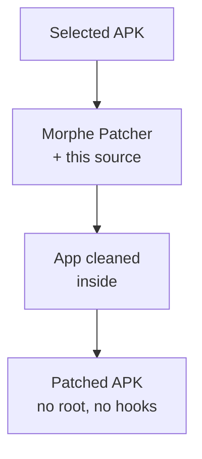

<a name="top"></a>
<p align="center">
  <a href="https://github.com/kveld9/kveld-morphe-patches/releases/latest"></a>
  <a href="https://github.com/kveld9/kveld-morphe-patches/stargazers"></a>
  <a href="https://github.com/kveld9/kveld-morphe-patches/releases"></a>
  
  <a href="LICENSE"></a>
</p>

<h1 align="center">Morphe Patches</h1>

<p align="center">
  Simple tweaks for <b>Brave Browser</b>, <b>Gboard Lite</b>, and <b>TikTok</b> on Android: fewer ads, less tracking, less battery drain. Applied with the <b><a href="https://morphe.software">Morphe</a></b> patcher.
</p>

<p align="center">
  <a href="https://morphe.software/add-source?github=kveld9/kveld-morphe-patches"></a>
  &nbsp;&nbsp;
  <a href="https://github.com/kveld9/kveld-morphe-patches/releases/latest"></a>
  &nbsp;&nbsp;
  <a href="https://t.me/kveldmorphe"></a>
</p>

---

<a name="table-of-contents"></a>
## Table of Contents


- [Quick Start](#quick-start)
- [Key Advantages](#key-advantages)
- [Supported Targets & Downloads](#supported-targets)
- [Patch Catalog](#patch-catalog)
- [Documentation & Guides](#documentation)
- [Contributing & Feature Requests](#contributing)
- [Community & Support](#community)
- [Credits & Contributors](#credits)
- [Legal Disclaimer](#legal)
- [License](#license)

---

<a name="quick-start"></a>
## Quick Start


1. Install **Morphe Manager** on your Android device.
2. Download the target app using the **exact version and variant** listed in [Supported Targets & Downloads](#supported-targets); the patches are built for that build and fail on any other.
3. Add this repository as a patch source with the button above, or add `https://github.com/kveld9/kveld-morphe-patches` manually.
4. Select the patches, keep a copy of the original APK, run the patcher, and install the rebuilt APK.

> [!NOTE]
> Requirements: Morphe Manager on your device. Patching runs on-device and needs no root.

---

<a name="key-advantages"></a>
## Key Advantages


- **No slowdown**: changes are baked into the app itself. No background services, no VPNs, no extra apps running.
- **Real privacy**: tracking and crash reporting are switched off inside the app, not just blocked on the network.
- **Smaller apps**: unused languages, files and extras are removed to save space and memory.
- **No root needed**: patching happens on your device with Morphe Manager. No root, no computer.
- **Tested targets**: every app pins one build, and its version is checked exactly before patching, so a wrong download is caught early.



---

<a name="supported-targets"></a>
## Supported Targets & Downloads


> [!TIP]
> Not sure which file fits your phone (ARM64 vs older 32-bit)? The [Compatibility Guide](docs/compatibility.md) explains which download to pick.

<!-- GENERATOR-SYNC: generate_patches_readme.py rewrites version cells and download URLs in this table in place via literal regexes — do not rename app cells, reorder columns, or remove backticks -->

| Application | Package ID | Target Version | Architecture / Variant | Download Source | Complete Guide |
| :--- | :--- | :--- | :--- | :--- | :--- |
| **Brave Browser** | `com.brave.browser` | `1.98.60` | `arm64-v8a`<br>`armeabi-v7a` (single file) | [ARM64](https://github.com/brave/brave-browser/releases/download/v1.98.60/Bravemonoarm64.apk) · [ARM32](https://github.com/brave/brave-browser/releases/download/v1.98.60/BraveMonoarm.apk) | [Brave Guide](docs/apps/brave.md) |
| **Gboard Lite** | `com.google.android.inputmethod.latin` | `18.5.1.993608717-lite_beta` | `arm64-v8a`<br>`armeabi-v7a` (any screen) | [APKMirror](https://www.apkmirror.com/apk/google-inc/gboard/gboard-the-google-keyboard-18-5-1-993608717-beta/) | [Gboard Lite Guide](docs/apps/gboard.md) |
| **TikTok** | `com.zhiliaoapp.musically` | `47.4.3` | `arm64-v8a` (any screen) | [APKMirror](https://www.apkmirror.com/apk/tiktok-pte-ltd/tik-tok-including-musical-ly/tiktok-47-4-3-release/) | [TikTok Guide](docs/apps/tiktok.md) |

Labels: `single file` = one APK; `multi-file` = a package Morphe joins together; `any screen` = works on any screen size.

<details>
<summary><b>Troubleshooting</b></summary>

- **App won't install**: the patched file carries a new signature, so uninstall the original app first (for Gboard, **Install a Copy** installs next to the original).
- **Google login broken (TikTok)**: enable **Fix Google Login**.
- **Patcher applies nothing / patching errors**: use the exact version and variant from the table above.
- **Crash after patching**: disable the last patch you enabled and retry.

</details>

---

<a name="patch-catalog"></a>
## Patch Catalog


<!-- PATCHES_START -->
<details>
<summary>TikTok&nbsp;&nbsp;•&nbsp;&nbsp;<b>49 patches</b></summary>
<br>

**Supported versions:**

| 47.4.3 |
| :---: |

| Patch | Description | Options |
|----------|----------------|-----------|
| **Allow Screenshots** | Removes screenshot and screen recording blocking. |  |
| **Always Show Publish Date** | Shows the upload date on all videos. |  |
| **Auto-Pause First Video** | Pauses the first video on launch so it plays without lag. |  |
| **Battery & Resource Saver** | Stops 3D ad sensors and aggressive video preloading to save battery and data. |  |
| **Block P2P Video Relay** | Stops your device from uploading videos to other users. |  |
| **Block Popups & Prompts** | Blocks popups, nags and promo dialogs across the app. | • Suppress Account & Permission Nags<br>• Suppress Sticker Recommendations<br>• Filter PopLayer Prompts & Nags<br>• Suppress Live Teaser Bubbles<br>• Suppress DM Streak Reminders<br>• Disable Post-Download Share Dialog<br>• Update Prompt Suppressor<br>• Skip First-Launch Onboarding<br>• Skip Content Warnings |
| **Block Trackers** | Neutralizes ByteDance AppLog tracking, crash monitors, and analytics. |  |
| **Block Trackers (Setup)** | Removes tracking permissions and disables telemetry components. |  |
| **Bypass Mandatory Login** | Lets you browse videos and feeds without creating an account or logging in. |  |
| **Camera & Microphone Indicator** | Shows a corner mark while TikTok holds camera/mic open. |  |
| **Clean Share Links** | Removes tracking parameters from shared links. | • Custom Share Host |
| **Comment Customizer** | Takes control of comments: sort, copy, translate and hide clutter. | • Comment Sort Controls<br>• Fix Silent Comment Drops<br>• Copy Comments Without Username<br>• Disable Suggested Emojis<br>• Hide Comment Quick Actions<br>• Hide Comment Surveys & Feedback Cards<br>• Hide Comment Story Rings<br>• Enable Voice Comments<br>• Hide Comment Popup Ads<br>• Show Community-Flagged Comments<br>• Auto-Translate Comments<br>• Do-Not-Translate Languages |
| **Custom Share Sheet** | Lets you hide share menu entries you do not use. | • Hide WhatsApp<br>• Hide Instagram<br>• Hide Facebook & Messenger<br>• Hide Telegram<br>• Hide X / Twitter<br>• Hide Snapchat<br>• Hide Reddit & Discord<br>• Hide SMS & Messages<br>• Hide Secondary Networks<br>• Hide 'Repost' Button<br>• Hide QR Code<br>• Hide 'Copy Link'<br>• Hide System Share ('More')<br>• Hide Friends / Direct Messages Row<br>• Hide Quick Emojis<br>• Hide 'Send to New Group'<br>• Hide 'Promote' Action<br>• Hide 'Why This Video'<br>• Hide 'Create Group' Action<br>• Hide 'Add to Story'<br>• Hide 'Create Sticker'<br>• Hide 'Duet' Action<br>• Hide 'Stitch' Action<br>• Hide 'Use This Effect'<br>• Hide 'Picture-in-Picture' (PiP)<br>• Hide 'Clear Display'<br>• Hide 'Background Audio'<br>• Hide Live Wallpaper & GIF<br>• Hide 'Not Interested'<br>• Hide 'Report' |
| **Customize Search** | Customizes search suggestions, live recommendations, and autoplay. | • Hide Suggested Searches<br>• Hide Popular Lives<br>• Disable Search Autoplay<br>• Non-Personalized Search<br>• Enable Live Search |
| **Declutter Direct Messages** | Cleans up chat and DM screens by hiding extra buttons. | • Hide Chat List Camera Button<br>• Hide Header Call Button<br>• Hide Message Forward Button<br>• Hide Reaction and Streak Bar<br>• Hide Input Bar Camera Button<br>• Hide Gallery Button<br>• Hide Emoji/Stickers Button<br>• Hide Voice Recording Button<br>• Hide Try Effect Button<br>• Hide Sticker Reply Suggestions |
| **Declutter Navigation Bar** | Removes extra tabs and buttons from navigation bars. | • Hide Shop Navigation Tab<br>• Hide Nearby Feed Tab<br>• Hide Community Tab<br>• Hide Top-Left LIVE Button<br>• Hide Feed Search Bar<br>• Hide Create / Publish Button<br>• Hide Friends Tab Avatar Preview<br>• Hide Inbox Notification Badge |
| **Declutter Video Interface** | Cleans up the buttons and overlays on top of videos. | • Hide Repost Badge<br>• Hide Video Descriptions<br>• Hide Profile Photo Follow Button<br>• Disable Story Feed Indicators<br>• Hide Playlist Bottom Bar<br>• Hide Save Button<br>• Hide Music Cover Disc<br>• Hide Full Screen Button<br>• Hide Feedback Buttons<br>• Disable Double Tap to Like<br>• Disable Profile Photo LIVE Status<br>• Disable Long-Press Like (Repost)<br>• Disable Long-Press Share (Quick DMs)<br>• Disable Long-Press Comment (Quick Emojis)<br>• Long Press Video Action |
| **Device Privacy Guard** | Blocks access to your contacts, location, apps and sensors. |  |
| **Disable History Recording** | Prevents TikTok from recording your watch history and search queries. | • Disable Watch History<br>• Disable Search History |
| **Disable Live Gift Effects** | Disables 3D gift animations in live streams to prevent frame drops. |  |
| **Disable On-Device AI** | Turns off on-device AI, the chatbot and AI search. |  |
| **Disable Push Notifications** | Stops background push notifications. |  |
| **Download Without Watermark** | Unlocks downloading and saves videos without watermarks. | • Remove Watermark<br>• Saved-Video Quality Preference |
| **Enable Profile Banner** | Unlocks the profile banner and its editing tools. |  |
| **Feed Ads & Content Filter** | Filters ads, shopping tags, live cards, and clutter from your feed. | • Filter Feed Ads<br>• Filter Feed Bloat<br>• Hide Video Product Anchors<br>• Block Live Streams<br>• Hide AI-Generated Content<br>• Hide Seen Videos<br>• Minimum Views<br>• Maximum Views<br>• Minimum Likes<br>• Maximum Likes<br>• Hide Stories<br>• Hide Photo Posts |
| **Force Auto-Scroll** | Enables native auto-scrolling to the next video. |  |
| **Friends & Suggestions Filter** | Keeps the Friends feed strictly mutual and hides suggested accounts across the app. | • Strict Mutual Friends Feed<br>• Filter Friends Feed Bloat<br>• Hide Suggested Accounts |
| **Hide Inbox Promos & Alerts** | Hides promo banners, streak cards and suggestions in your inbox. | • Hide Top Promotional Banners<br>• Hide Contact & Friend Recommendations<br>• Hide Navigation Notices & Tooltips |
| **Hide Inbox Story Tray** | Hides the stories and status tray at the top of the inbox. | • Hide Suggested Stories Only |
| **In-App Browser Privacy Guard** | Opens web links in your browser and blocks tracking in the remaining web views. |  |
| **Instant Launch** | Opens the app immediately without splash screens or ad delays. |  |
| **Login Compatibility Fix** | Restores Google and Spotify sign-in on modified app builds. | • Fix Google Login<br>• Fix Spotify Login |
| **Offline Video Limit** | Customizes the maximum number of videos saved for offline viewing. | • Custom Offline Videos Limit |
| **Playback & Display Governor** | Limits playback resolution and HDR to save battery, and locks the screen refresh rate. | • Cap Playback Resolution<br>• Maximum Playback Resolution<br>• Avoid ByteVC2 Software Decoding<br>• Drop Undecodable Video Streams<br>• Disable HDR Video Playback<br>• Govern Display Refresh Rate<br>• Target Refresh Rate |
| **Remember Clear Display** | Keeps clear-display mode active when scrolling to the next video. |  |
| **Remember Playback Speed** | Keeps your chosen playback speed across videos and restarts. | • Hold-And-Slide 2x Speed Lock |
| **Remove Creator Tools** | Removes video editing and effects tools to free up space. |  |
| **Remove Extra Files** | Removes card scanners, AI engines and extra fonts to save space. |  |
| **Remove Extra Languages** | Deletes unselected language packs. | • Languages to keep |
| **Remove Live Stream Files** | Removes live streaming and minigame files. Breaks lives and video calls. |  |
| **Remove Voice Tools** | Removes voice search and text-to-speech to save space. Breaks voice features. |  |
| **Resume Video After Scroll** | Resumes playback from where you left off when returning to a video. |  |
| **SIM Region Selector** | Locks the app to a chosen country to unlock regional content. | • Spoofed Region ISO Code<br>• Spoofed Operator Numeric Code (MCC+MNC)<br>• Spoofed Operator Name |
| **Show Author Region** | Displays the creator's country code next to their username. |  |
| **Show Seekbar** | Restores the video progress seekbar and scrubbing controls. | • Show Thumbnail Preview |
| **Stop Video Looping** | Stops videos at the end instead of replaying them in an infinite loop. |  |
| **Strip Sensitive Permissions** | Removes sensitive hardware, sensor, and tracking permissions. | • Strip Notification Permission<br>• Strip Camera Permission<br>• Strip Microphone Permissions<br>• Strip Storage & Media Permissions<br>• Strip Bluetooth Permissions<br>• Strip NFC Permission<br>• Strip Biometric Permissions<br>• Strip Foreground Service Permissions<br>• Strip System Alert Window Permission<br>• Strip Wake Lock Permission<br>• Strip Screenshot & Recording Detection Permissions<br>• Strip Miscellaneous Hardware & System Permissions<br>• Strip OEM Diagnostic & Background Signals<br>• Strip Push Delivery Permissions<br>• Strip In-App Billing Permission |
| **Use System Font** | Uses the system font instead of bundled TikTok fonts. |  |
| **Video Fit Mode** | Lets you choose between fitting the whole video or filling the screen. | • Video Fit Mode |

</details>

<details>
<summary>Gboard Lite&nbsp;&nbsp;•&nbsp;&nbsp;<b>12 patches</b></summary>
<br>

**Supported versions:**

| 18.5.1.993608717-lite_beta-armeabi-v7a | 18.5.1.993608717-lite_beta-arm64-v8a |
| :---: | :---: |

| Patch | Description | Options |
|----------|----------------|-----------|
| **Block App Hijacking** | Protects against other apps hijacking Gboard and removes debug tools. |  |
| **Block Trackers** | Stops background metrics, event logging and crash reporting. | • Block ad servers |
| **Disable Cloud Backup** | Keeps keyboard data off Google Drive backups. |  |
| **Disable Play Services** | Runs without Google Play services. Also turns off inline Translate. |  |
| **Install a Copy** | Installs this Gboard next to the original one. | • Package name suffix<br>• App display name |
| **Keyboard Settings** | Adds a settings screen inside Gboard: theme, vibration, clipboard and more. |  |
| **Offline Only** | Fully disconnects Gboard. Download dictionaries first. |  |
| **Remove Extra Files** | Deletes licenses, tutorial animations and junk. |  |
| **Remove Permissions** | Removes permissions you pick below. | • Contacts<br>• Microphone<br>• Photos & files<br>• Dictionary sync<br>• Work profile link |
| **Remove Translate Limit** | Removes the character limit for inline translation. |  |
| **Stop Background Sync** | Stops background downloads and sync to save battery. |  |
| **Stop Remote Updates** | Stops Google from changing settings remotely. |  |

</details>

<details>
<summary>Brave Private Web Browser, VPN&nbsp;&nbsp;•&nbsp;&nbsp;<b>13 patches</b></summary>
<br>

**Supported versions:**

| 1.98.60 |
| :---: |

| Patch | Description | Options |
|----------|----------------|-----------|
| **Block Motion Sensors** | Stops sites from reading motion sensors to identify you. |  |
| **Block Popups & Rating Requests** | Blocks rating popups, review requests and promo dialogs. |  |
| **Block Trackers** | Blocks usage analytics, crash uploads and experiment downloads. | • Block offers server |
| **Brave Origin** | Unlocks Brave Origin feature switches. |  |
| **Clean Start Page** | Removes sponsored wallpapers, news feed and promo cards. | • Hide shortcut tiles |
| **Keep Tabs Open** | Stops Brave from minimizing your tabs in the background. |  |
| **Remove Extra Files** | Deletes unused AR and XR files to shrink the app. | • Remove VPN library |
| **Remove Extra Languages** | Deletes unselected language packs. | • Languages to keep |
| **Select Previous Tab on Close** | Selects the previous tab in the tab group when closing a tab. |  |
| **Silence Promo Notifications** | Stops tips, reward promos and marketing notifications. |  |
| **Skip Welcome Screens** | Skips welcome, search choice and onboarding on fresh installs. |  |
| **Stop Background Sync** | Stops background wakeups and battery drain. |  |
| **Stop Text Sharing with System** | Stops sending page text to the Android capture service. |  |

</details>

<details>
<summary>Universal&nbsp;&nbsp;•&nbsp;&nbsp;<b>19 patches</b></summary>
<br>

| Patch | Description | Options |
|----------|----------------|-----------|
| **Allow Screenshots (Universal)** | Removes screenshot blocking and capture detection. |  |
| **Block Trackers (Universal)** | Removes ad IDs, disables tracking components, and adds opt-out flags. | • Ad permissions<br>• Tracking providers<br>• Tracking services<br>• Tracking receivers<br>• Opt-out flags<br>• Firebase init (may break apps)<br>• Push services (breaks push!)<br>• Google Analytics<br>• Meta analytics<br>• Crash uploaders<br>• Device ID (may break login!)<br>• ML Kit vision (breaks scanner!)<br>• Remote config (may break app!)<br>• Crashlytics (may break app!)<br>• Ad auto-start |
| **Block Tracking SDKs** | Disables analytics, crash and ad SDKs inside the app. | • Performance monitors<br>• Crash reporters<br>• Analytics<br>• Ad attribution<br>• Old Google Analytics<br>• Push SDKs (breaks push!)<br>• Screen recorders<br>• Location trackers<br>• Bandwidth-sharing SDKs<br>• SDKs to keep |
| **Block Tracking Servers (Universal)** | Rewrites tracking addresses to nowhere using your blocklist. | • Blocklist file<br>• Replace with<br>• Include subdomains |
| **Clean App Packaging** | Removes build leftovers and duplicate files. |  |
| **Disable Browser File Associations** | Removes HTTP/HTTPS web-link intent filters (VIEW + BROWSABLE) so the app no longer appears in the browser app chooser for online files, while preserving local file handling. | • Strip HTTP/HTTPS Web Schemes<br>• Remove Emptied Filters |
| **Disable Play Store updates** | Disables Play Store updates by setting the version code to the maximum allowed. |  |
| **Force Screen Timeout** | Makes apps respect your screen-off timer. |  |
| **Go Fully Offline** | Removes internet access completely. | • Network state<br>• Wi-Fi controls<br>• Push permissions<br>• Google sync<br>• Block unencrypted traffic |
| **Lock Screen Brightness** | Stops apps from changing brightness by themselves. |  |
| **Remove Extra Languages (Universal)** | Deletes unselected translation folders. | • Languages to keep |
| **Remove Tracking Libraries** | Deletes tracking and crash-reporting native libraries. | • Crash reporters<br>• Debuggers<br>• Bandwidth-sharing SDKs |
| **Remove Unused Screen Sizes** | Deletes image folders for screen sizes you do not use. | • Screen sizes to keep<br>• Watch resources<br>• TV resources<br>• Car, dock and VR resources |
| **Shrink PNG Images** | Recompresses PNGs without losing quality. |  |
| **Shrink WebP Images** | Strips hidden metadata from WebP images. | • Camera data<br>• Editing history<br>• Color profiles |
| **Silence System Logs** | Stops apps from writing debug and diagnostic messages to the system log. | • Log level |
| **Spoof Reinstall IDs** | Prevents apps from linking reinstalls to your device by resetting app and install IDs. | • App set ID<br>• Install ID<br>• Scope to single app |
| **Stop Background Sync (Universal)** | Stops background sync schedulers and boot wakeups. | • Strip Boot Permission<br>• Disable Boot Receivers<br>• Disable Background Schedulers<br>• Strip Wake Lock Permission |
| **Strip Sensitive Permissions (Universal)** | Removes sensitive privacy and hardware permissions you select. | • Notifications<br>• Camera<br>• Microphone<br>• Photos & files<br>• Location<br>• Contacts<br>• Calendar<br>• Nearby devices<br>• Body sensors<br>• Installed apps |

</details>

<!-- PATCHES_END -->

<p align="center">
  <a href="#top"><b>&uarr; Back to top</b></a>
</p>

---

<a name="documentation"></a>
## Documentation & Guides


Technical references, setup manuals, and architecture notes are organized by focus area:

### Dedicated Application Guides
| Application | Guide | Description |
| :--- | :--- | :--- |
| **Brave Browser** | **[Brave Guide](docs/apps/brave.md)** | Faster start, no ads or tracking, clean start page. |
| **Gboard Lite** | **[Gboard Lite Guide](docs/apps/gboard.md)** | Offline dictionaries, keyboard settings, no tracking. |
| **TikTok** | **[TikTok Guide](docs/apps/tiktok.md)** | Change country, block ads, save clean videos, save battery. |

### Universal & Architecture Reference
| Guide | Description |
| :--- | :--- |
| **[Universal Patches & Options](docs/universal-patches.md)** | Works on any app: remove languages, shrink images, go offline, block trackers, allow screenshots. |
| **[Compatibility Guide](docs/compatibility.md)** | Which file to download for your phone and how versions are checked. |
| **[Project Scope & Out of Scope](docs/out-of-scope.md)** | Non-negotiable design philosophy, compile-time invariants, and rejected feature categories. |
| **[Architecture & Security Notes](docs/architecture-security.md)** | Static analysis scanner false positives (ML Kit, Play Billing) and native ELF telemetry neutralization. |

### Developer & Tooling
| Guide | Description |
| :--- | :--- |
| **[Building & Development](docs/building.md)** | Toolchain prerequisites, Gradle build tasks, test execution, and catalog synchronization. |
| **[Physical & Runtime ADB Test Suite](validation/physical_harness/README.md)** | Automated on-device validation for ServiceWorker sync and runtime telemetry. |

<p align="center">
  <a href="#top"><b>&uarr; Back to top</b></a>
</p>

---

<a name="contributing"></a>
## Contributing & Feature Requests


Before proposing new features or submitting modifications, please review our **[Project Scope & Out-of-Scope Philosophy](docs/out-of-scope.md)**.

> [!NOTE]
> We prioritize **small, fast changes** and keeping up with the latest app versions. Dynamic in-app settings panels, legacy multi-version support, server-side exploits, or heavy feature bloat are explicitly out of scope.

### Mandatory Verification Gates
Every patch modification or contribution must pass the in-situ patching test with 100% success (0 failed patches, 0 fingerprint mismatches):
```bash
# Patch the target app with every patch and every option enabled
./gradlew runPatchTest -Papp=<targetApp> -PallOptions=true   # targetApp is the app id (see docs/apps/)
```
Additionally, ensure all Gradle checks pass cleanly:
```bash
./gradlew check
```

---

<a name="community"></a>
## Community & Support


> [!NOTE]
> Need assistance, have questions regarding patch configurations, or want to follow release announcements? Join the official Telegram community:
>
> - **Telegram Support Group**: [t.me/kveldmorphe](https://t.me/kveldmorphe)
> - **Bug reports & feature requests**: [GitHub Issues](https://github.com/kveld9/kveld-morphe-patches/issues/new/choose)
> - **Security vulnerabilities**: see [SECURITY.md](SECURITY.md) (do not open public issues)
> - **Release notes**: [CHANGELOG.md](CHANGELOG.md)

**Related project**: [kveld-extra-morphe-patches](https://github.com/kveld9/kveld-extra-morphe-patches) is the companion collection holding app-specific patches for additional standalone targets.

---

<a name="credits"></a>
## Credits & Contributors


<!-- CONTRIBUTORS_START -->
| Contributor | Role & Contributions |
| :--- | :--- |
| <a href="https://github.com/Lxchoooo"><br><b>@Lxchoooo</b></a> | Testing: Daily patch testing, runtime APK validation, and bug diagnostics. |
| <a href="https://github.com/Diego694"><br><b>@Diego694</b></a> | Testing: Daily patch testing, runtime APK validation, and bug diagnostics. |
| <a href="https://github.com/ll0r3nt3"><br><b>@ll0r3nt3</b></a> | Feature request: Proposed DPI Resource Slimmer feature request ([#16](https://github.com/kveld9/kveld-morphe-patches/issues/16)). |
| <a href="https://github.com/aidenking2102-dotcom"><br><b>@aidenking2102-dotcom</b></a> | Feature request: Proposed TikTok Feed Ad Blocker ([#23](https://github.com/kveld9/kveld-morphe-patches/issues/23)), Playback Speed Setter ([#25](https://github.com/kveld9/kveld-morphe-patches/issues/25)), and Floating Ad Pendant / Sticker Blocker ([#33](https://github.com/kveld9/kveld-morphe-patches/issues/33)) feature requests. |
| <a href="https://github.com/mparvezalam808"><br><b>@mparvezalam808</b></a> | Feature request: Proposed TikTok Always show publish date, Copy comments without username, Fix Google login, and Show seekbar ([#35](https://github.com/kveld9/kveld-morphe-patches/issues/35)) and TikTok Custom offline videos limit ([#40](https://github.com/kveld9/kveld-morphe-patches/issues/40)) feature requests. |
| <a href="https://github.com/raxelbyte"><br><b>@raxelbyte</b></a> | Feature request: Proposed Gboard Lite Clipboard Enhancements feature request ([#17](https://github.com/kveld9/kveld-morphe-patches/issues/17)). |
| <a href="https://github.com/rafipasya"><br><b>@rafipasya</b></a> | Feature request: Proposed TikTok Auto-translate comments feature request ([#48](https://github.com/kveld9/kveld-morphe-patches/issues/48)). |
| <a href="https://github.com/Fahry-a"><br><b>@Fahry-a</b></a> | Feature request: Proposed Brave ARMv7a (32-bit) architecture support feature request ([#50](https://github.com/kveld9/kveld-morphe-patches/issues/50)). |
| <a href="https://github.com/marcoodhb"><br><b>@marcoodhb</b></a> | Feature request: Proposed TikTok Disable double tap to like feature request ([#55](https://github.com/kveld9/kveld-morphe-patches/issues/55)). |
| <a href="https://github.com/miyqwx-dev"><br><b>@miyqwx-dev</b></a> | Feature request: Proposed Gboard Lite Hide Incognito Icon toggle feature request. |
| <a href="https://github.com/rdx011"><br><b>@rdx011</b></a> | Feature request: Proposed Gboard Lite Decouple keyboard vibration from system touch feedback ([#69](https://github.com/kveld9/kveld-morphe-patches/issues/69)) and A Universal Patch to Disable Browser File Associations ([#93](https://github.com/kveld9/kveld-morphe-patches/issues/93)) feature requests. |
| <a href="https://github.com/nightsper"><br><b>@nightsper</b></a> | Feature request: Proposed Tab selection after deleting a tab in a tab group feature request ([#76](https://github.com/kveld9/kveld-morphe-patches/issues/76)). |
| <a href="https://github.com/nadr21a21"><br><b>@nadr21a21</b></a> | Feature request: Proposed Gboard lite Option to pause automatic deletion in clipboard feature request ([#61](https://github.com/kveld9/kveld-morphe-patches/issues/61)). |
| <a href="https://github.com/polosugars-sketch"><br><b>@polosugars-sketch</b></a> | Feature request: Proposed Include other monetization SDKs in the patches feature request ([#164](https://github.com/kveld9/kveld-morphe-patches/issues/164)). |
<!-- CONTRIBUTORS_END -->

---

<a name="legal"></a>
## Legal Disclaimer


**Morphe Patches** is an independent, community-driven open-source project and is not affiliated, associated, authorized, endorsed by, or in any way officially connected with any of the respective app publishers or their subsidiaries or affiliates.

All product names, logos, brands, and registered trademarks mentioned in this repository are the property of their respective holders. Their inclusion does not imply affiliation with or endorsement by them.

---

<a name="license"></a>
## License


Morphe Patches is open-source software licensed under the [GNU General Public License v3.0](LICENSE).

---

<p align="center">
  <a href="#top"><b>&uarr; Back to top</b></a>
</p>
